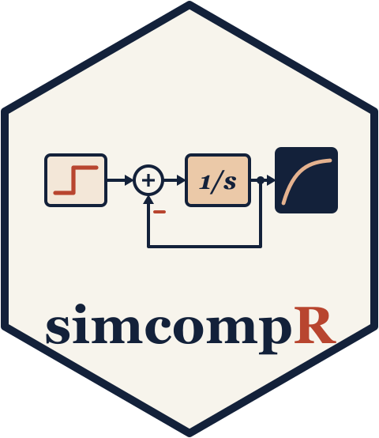

# simcompR: Block-Diagram Simulation of Dynamical Systems in R 

<!-- badges: start -->
[](https://github.com/adamrsophie/simcompR/actions/workflows/R-CMD-check.yaml)
[](https://github.com/adamrsophie/simcompR/actions/workflows/cran-check.yaml)
[](https://app.codecov.io/gh/adamrsophie/simcompR)
[](https://adamrsophie.github.io/simcompR/)
[](https://lifecycle.r-lib.org/articles/stages.html#experimental)
[](https://www.gnu.org/licenses/gpl-3.0)
<!-- Software Heritage has not archived the repository yet; uncomment once it has. -->
<!-- [](https://archive.softwareheritage.org/browse/origin/?origin_url=https://github.com/adamrsophie/simcompR) -->
<!-- DOI badge: Zenodo mints a concept DOI on the first GitHub release; replace XXXXXXXX and uncomment. -->
<!-- [](https://doi.org/10.5281/zenodo.XXXXXXXX) -->
<!-- badges: end -->

***simcompR*** builds and simulates block diagrams in R, in the spirit of
Simulink and Python's bdsim. A model is a graph of blocks connected by
signal wires. It is compiled into an execution plan and then simulated:

**model, connections, compilation (sizes, feedthrough graph, execution
order), continuous integration, sample hits, events, results**.

Continuous dynamics are integrated with
[deSolve](https://cran.r-project.org/package=deSolve). Discrete blocks run
at exact sample times, several rates can be mixed, zero crossings are
located by root finding, and algebraic loops are detected (and, on
request, solved).

## Installation

```r
# install.packages("remotes")
remotes::install_github("adamrsophie/simcompR")
```

## Quick start

A proportional controller with a saturating actuator and a first-order
plant:

```r
library(simcompR)

m <- sim_model("loop", params = list(K = 4))
sim_add_block(m, "step", "reference", time = 1)
sim_add_block(m, "subtract", "error")
sim_add_block(m, "gain", "controller", gain = sim_param("K"))
sim_add_block(m, "saturation", "actuator", lower = -2, upper = 2)
sim_add_block(m, "transfer_function", "plant", num = 1, den = c(0.5, 1))
sim_connect(m, "reference", "error", input = 1)
sim_connect(m, "plant", "error", input = 2)
sim_connect(m, "error", "controller")
sim_connect(m, "controller", "actuator")
sim_connect(m, "actuator", "plant")

plan <- sim_compile(m)          # sizes, feedthrough graph, execution order
r <- sim_run(plan, c(0, 5))
plot(r, c("reference", "plant", "actuator"))

# same structure, different gain
r2 <- sim_run(sim_set_params(plan, K = 10), c(0, 5))
```

The loop through `plant` is legal because a strictly proper transfer
function has no direct feedthrough. A loop made only of gains and sums is
an algebraic loop and is reported at compile time.

## What is implemented

| Area | Features |
|------|----------|
| Models | blocks, named and numbered ports, connections, model parameters, copies, editing |
| Compilation | size propagation, direct-feedthrough graph, Tarjan components, deterministic order, plan reuse |
| Continuous | integrator, transfer function, state space, general and autonomous `ode` blocks; deSolve methods that can stop at given times (all but `radau`, `iteration` and `ode23`) |
| Discrete | unit delay, zero-order hold, discrete integrators, discrete state space and transfer functions |
| Multirate | several sample rates and offsets, exact hit times, outputs before updates, rate notes |
| Hybrid | scheduled and zero-crossing events, resets, events on subsystem internals, located kinks of saturation and similar blocks, switch, relay, stop, event limits |
| Algebraic loops | detection with a printed cycle; optional Newton solution with starting values and diagnostics |
| Structure | reusable subsystems, nesting, parameter namespaces, parameter expressions |
| Logic | state machines with guards, priorities, timed transitions, actions |
| Experiments | parameter sweeps, Monte Carlo with fixed seeds, seeded noise, optional parallel runs |
| Files | versioned JSON with exact numbers; non-portable content refused, expressions whitelisted |
| Results | signals, states, events, data frames, plots, diagnostics, DOT export |

Not implemented: graphical editing, code generation, physical (acausal)
modeling, consistent DAE initialization, buses. See the known limitations
and the roadmap in `NEWS.md`.

## Validation

The test suite compares simulations with closed-form answers: exponential
decay, harmonic motion, the matrix exponential, second-order step
responses, discrete recurrences, sampled control against exact
zero-order-hold discretization, multirate timelines and bouncing ball
impact times. It runs on Linux, macOS and Windows for every change.
`vignette("validation")` reproduces the comparisons.

## Documentation

Fifteen vignettes cover the package from a first model to custom blocks;
start with `vignette("simcompR")` or the
[website](https://adamrsophie.github.io/simcompR/).

## Related packages

simcompR belongs to a family of R packages by the same author:
[symcompR](https://github.com/adamrsophie/symcompR) (symbolic computation),
[modelcompR](https://github.com/adamrsophie/modelcompR) (equation-based
modeling), [jaxR](https://github.com/adamrsophie/jaxR) (differentiable
computation), [z3r](https://github.com/adamrsophie/z3r) (constraint
solving), [optcompR](https://github.com/adamrsophie/optcompR)
(optimization), [graphlearnR](https://github.com/adamrsophie/graphlearnR),
[pdecompR](https://github.com/adamrsophie/pdecompR) (finite elements) and
[controlcompR](https://github.com/adamrsophie/controlcompR) (control).
simcompR works on its own; integrations are planned and will stay optional.

## License

GPL-3.
