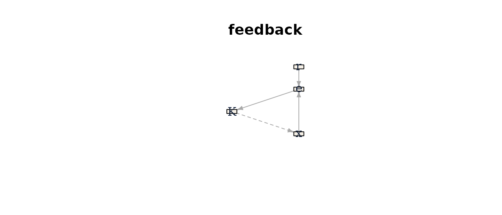

# Graph compilation and execution order

``` r

library(simcompR)
```

[`sim_compile()`](https://adamrsophie.github.io/simcompR/reference/sim_compile.md)
separates *what the model is* from *how it is executed*. It turns a
mutable `sim_model` into an immutable `sim_plan` that can be run many
times. This vignette walks through the stages.

## Stages

1.  **Flatten** subsystems into leaf blocks named `instance/block` and
    resolve
    [`sim_param()`](https://adamrsophie.github.io/simcompR/reference/sim_param.md)
    references.
2.  **Build** each block from its type and parameters. Invalid
    parameters fail here, with the block name in the message.
3.  **Validate connections**: blocks and ports exist, every input has
    exactly one source.
4.  **Propagate sizes** along connections and check compatibility.
5.  **Build the direct-feedthrough graph**: an edge A \to B exists when
    an output of A feeds an input of B on which B’s outputs depend at
    the same instant.
6.  **Find strongly connected components** (Tarjan’s algorithm). A
    component with more than one block, or a block that feeds itself, is
    an algebraic loop.
7.  **Order** the components topologically (Kahn’s algorithm).
8.  **Lay out** the signal, continuous state and discrete state vectors
    and collect sample times, zero crossings and events.

## Direct feedthrough

A block has direct feedthrough on an input if its outputs at time t
depend on that input at time t. Gains, sums and products do;
integrators, unit delays, strictly proper transfer functions and
state-space blocks with D = 0 do not. Only feedthrough connections
become edges of the dependency graph.

``` r

m <- sim_model("feedback")
sim_add_block(m, "constant", "r")
sim_add_block(m, "subtract", "e")
sim_add_block(m, "gain", "K", gain = 3)
sim_add_block(m, "integrator", "x")
sim_connect(m, "r", "e", input = 1)
sim_connect(m, "x", "e", input = 2)
sim_connect(m, "e", "K")
sim_connect(m, "K", "x")
d <- sim_diagnostics(sim_compile(m))
d$edges
#>   from to
#> 1    e  K
#> 2    r  e
#> 3    x  e
d$order
#> [1] "r" "x" "e" "K"
```

There is no edge into `x`: its input does not affect its output at the
same instant. The DOT export draws such connections dashed:

``` r

cat(sim_to_dot(m))
#> digraph "feedback" {
#>   rankdir=LR;
#>   "r" [shape=box, label="r\n(constant)"];
#>   "e" [shape=box, label="e\n(subtract)"];
#>   "K" [shape=box, label="K\n(gain)"];
#>   "x" [shape=box, label="x\n(integrator)"];
#>   "r" -> "e" [label="1:1"];
#>   "x" -> "e" [label="1:2"];
#>   "e" -> "K" [label="1:1"];
#>   "K" -> "x" [label="1:1", style=dashed];
#> }
```

With ‘igraph’ installed, `plot(m)` draws the diagram.

``` r

plot(m)
```



## Determinism and insertion order

Blocks are identified by name, and ties in the topological sort are
broken by name. The execution order and the layout of the state vector
therefore depend only on the graph, never on the order in which blocks
or connections were added:

``` r

build <- function(order) {
  m <- sim_model("shuffled")
  adds <- list(
    function() sim_add_block(m, "constant", "r"),
    function() sim_add_block(m, "subtract", "e"),
    function() sim_add_block(m, "integrator", "x"))
  for (i in order) adds[[i]]()
  sim_connect(m, "e", "x")
  sim_connect(m, "x", "e", input = 2)
  sim_connect(m, "r", "e", input = 1)
  m
}
a <- sim_run(sim_compile(build(1:3)), c(0, 2))
b <- sim_run(sim_compile(build(c(3, 1, 2))), c(0, 2))
identical(a$signals, b$signals)
#> [1] TRUE
```

The same plan with the same parameters and solver settings always gives
bit-for-bit identical results.

## Plans are snapshots

Editing a model after compiling does not affect existing plans.
Recompile to pick up changes.

``` r

plan <- sim_compile(m)
sim_set_block_params(m, "K", gain = 10)
sim_signal(sim_run(plan, c(0, 1), times = 1), "K") /
  sim_signal(sim_run(plan, c(0, 1), times = 1), "e")
#> K 
#> 3
```

## Parameter changes and recompilation

[`sim_set_params()`](https://adamrsophie.github.io/simcompR/reference/sim_set_params.md)
rebuilds blocks with new model parameters. When sizes, feedthrough,
state dimensions, sample times and connections are unchanged the graph
analysis is reused (`structure_reused` is `TRUE`). A parameter that
changes structure triggers a fresh analysis:

``` r

s <- sim_model("ss", params = list(D = 0))
sim_add_block(s, "constant", "u")
sim_add_block(s, "sum", "e", signs = "+-")
sim_add_block(s, "state_space", "G", A = -1, B = 1, C = 1, D = sim_param("D"))
sim_connect(s, "u", "e", input = 1)
sim_connect(s, "G", "e", input = 2)
sim_connect(s, "e", "G")
p0 <- sim_compile(s, algebraic_loops = "solve")
length(p0$graph$loops)
#> [1] 0
p1 <- sim_set_params(p0, D = 0.5)
c(reused = p1$structure_reused, loops = length(p1$graph$loops))
#> reused  loops 
#>      0      1
```

With D \neq 0 the state-space block gains direct feedthrough and the
feedback becomes an algebraic loop.

## Diagnostics

[`sim_diagnostics()`](https://adamrsophie.github.io/simcompR/reference/sim_diagnostics.md)
on a plan returns the order, the loops, the dependency edges, the sample
rates and notes about rate transitions. On a result it returns the
solver status and statistics.
