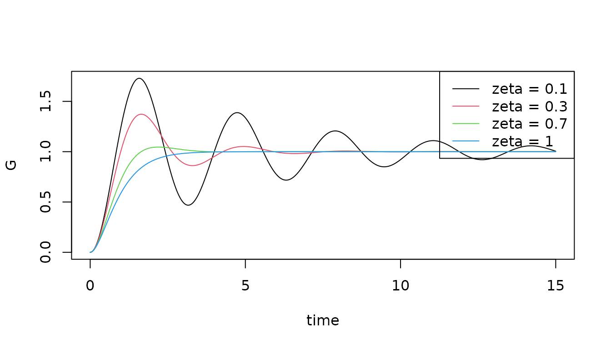
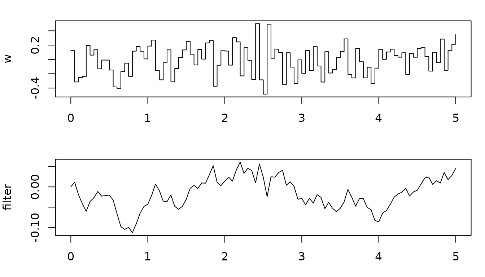

# Parameter sweeps and Monte Carlo experiments

``` r

library(simcompR)
```

A compiled plan can be run many times with different parameters. Model
parameters are declared in `sim_model(params = )` and referenced from
blocks with
[`sim_param()`](https://adamrsophie.github.io/simcompR/reference/sim_param.md).

## A second-order system

G(s) = \frac{\omega^2}{s^2 + 2\zeta\omega s + \omega^2} with \omega = 2
and a unit step input. Parameters can be any R value, including vectors,
so the whole denominator is one parameter:

``` r

second <- sim_model("second_order", params = list(den = c(1, 0.8, 4), num = 4))
sim_add_block(second, "step", "u", time = 0)
sim_add_block(second, "transfer_function", "G",
              num = sim_param("num"), den = sim_param("den"))
sim_connect(second, "u", "G")
plan <- sim_compile(second)
```

Parameters can be combined where they are used. Writing the system with
\zeta and \omega as parameters keeps the denominator in its textbook
form; the expression is evaluated again for every run:

``` r

named <- sim_model("second_order_zw", params = list(zeta = 0.2, w = 2))
sim_add_block(named, "step", "u", time = 0)
sim_add_block(named, "transfer_function", "G",
              num = sim_param("w")^2,
              den = sim_param_expr("c(1, 2 * zeta * w, w^2)"))
sim_connect(named, "u", "G")
zw <- sim_compile(named)
peak_of <- function(p) max(sim_signal(sim_run(p, c(0, 15), times = seq(0, 15, 0.01)), "G"))
c(zeta_0.2 = peak_of(zw), zeta_0.5 = peak_of(sim_set_params(zw, zeta = 0.5)))
#> zeta_0.2 zeta_0.5 
#> 1.526610 1.163029
```

Model parameters are also visible by name inside `expression` blocks and
state machine guards and actions.

## Sweeps

[`sim_sweep()`](https://adamrsophie.github.io/simcompR/reference/sim_sweep.md)
takes a data frame with one row per run, or a list of named lists for
vector-valued parameters. `summary` reduces each result to named
numbers.

``` r

dens <- lapply(c(0.1, 0.3, 0.7, 1), function(z) list(den = c(1, 2 * z * 2, 4)))
peak <- function(r) {
  y <- sim_signal(r, "G")
  t <- sim_times(r)
  outside <- which(abs(y - 1) > 0.02)
  c(peak = max(y), settle = if (length(outside)) t[max(outside)] else 0)
}
s <- sim_sweep(plan, dens, tspan = c(0, 15), times = seq(0, 15, 0.01), summary = peak)
s
#> <sim_sweep> 4 run(s): success = 4
#>   run       den     peak settle  status
#> 1   1 1, 0.4, 4 1.729245  14.84 success
#> 2   2 1, 1.2, 4 1.372318   5.61 success
#> 3   3 1, 2.8, 4 1.045988   2.98 success
#> 4   4   1, 4, 4 1.000000   2.91 success
cbind(zeta = c(0.1, 0.3, 0.7, 1), s$summary[c("peak", "settle")],
      exact_peak = c(1 + exp(-pi * c(0.1, 0.3, 0.7) / sqrt(1 - c(0.1, 0.3, 0.7)^2)), 1))
#>   zeta     peak settle exact_peak
#> 1  0.1 1.729245  14.84   1.729248
#> 2  0.3 1.372318   5.61   1.372326
#> 3  0.7 1.045988   2.98   1.045988
#> 4  1.0 1.000000   2.91   1.000000
```

The overshoot matches the classical formula 1 +
e^{-\pi\zeta/\sqrt{1-\zeta^2}}.

``` r

cols <- seq_along(s$results)
matplot(sim_times(s$results[[1]]), sapply(s$results, sim_signal, "G"),
        type = "l", lty = 1, col = cols, xlab = "time", ylab = "G")
legend("topright", paste("zeta =", c(0.1, 0.3, 0.7, 1)), col = cols, lty = 1)
```



### Reuse of the compiled structure

Each run calls
[`sim_set_params()`](https://adamrsophie.github.io/simcompR/reference/sim_set_params.md).
When a new value keeps sizes, feedthrough, state dimensions and sample
times, the graph analysis is reused; otherwise it is redone. Changing
the order of the denominator above would change the number of states and
trigger a fresh analysis automatically.

## Monte Carlo

[`sim_monte_carlo()`](https://adamrsophie.github.io/simcompR/reference/sim_sweep.md)
draws parameter sets under a fixed seed. The caller’s random stream is
saved and restored, so the experiment is reproducible and does not
disturb other random code:

``` r

set.seed(2024)
before <- runif(1)
set.seed(2024)
mc <- sim_monte_carlo(plan, n = 50,
  sampler = function(i) list(den = c(1, 2 * runif(1, 0.1, 0.9) * 2, 4)),
  seed = 1, tspan = c(0, 15), times = seq(0, 15, 0.05), keep = FALSE,
  summary = function(r) c(peak = max(sim_signal(r, "G"))))
after <- runif(1)
identical(before, after)
#> [1] TRUE
summary(mc$summary$peak)
#>    Min. 1st Qu.  Median    Mean 3rd Qu.    Max. 
#>   1.002   1.043   1.126   1.198   1.277   1.704
hist(mc$summary$peak, main = "Peak response", xlab = "peak")
```


Running it again with the same seed returns identical numbers.

## Noise inputs

`white_noise` blocks draw a value at each sample hit from their own
seed, the hit index and the element index, with a counter-based
generator that never touches R’s random number generator. Results are
reproducible, do not depend on the global random state and leave it
untouched:

``` r

nm <- sim_model("noisy")
sim_add_block(nm, "white_noise", "w", sd = 0.2, period = 0.05, seed = 3)
sim_add_block(nm, "transfer_function", "filter", num = 1, den = c(0.5, 1))
sim_connect(nm, "w", "filter")
r1 <- sim_run(sim_compile(nm), c(0, 5))
r2 <- sim_run(sim_compile(nm), c(0, 5))
identical(r1$signals, r2$signals)
#> [1] TRUE
plot(r1, c("w", "filter"))
```



## Failures inside experiments

Runs that fail are kept with status `"failed"` and missing summaries;
they are never silently dropped. Use `s$status` and `s$messages` to
inspect them.

## Parallel runs

`cores > 1` runs simulations with
[`parallel::mclapply()`](https://rdrr.io/r/parallel/mclapply.html) on
Unix-like systems. Results do not depend on the number of cores, because
every run is deterministic and seeds are drawn before the runs start.
