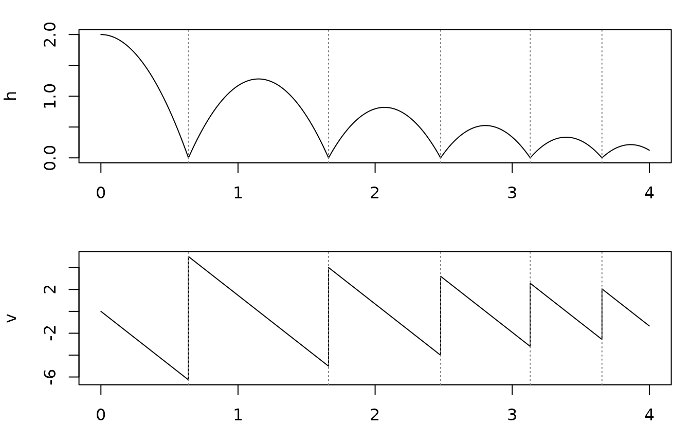
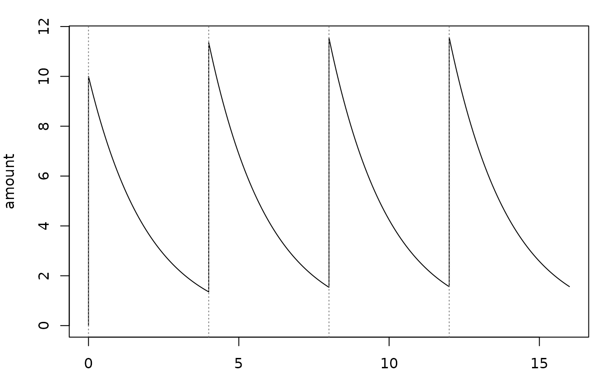
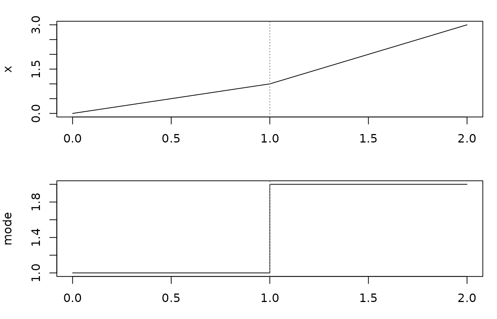
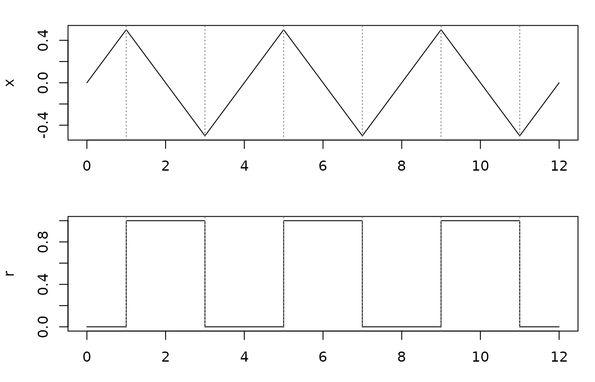

# Hybrid dynamics, events and zero crossings

``` r

library(simcompR)
```

Hybrid systems combine continuous evolution with instantaneous changes:
resets, mode switches and stops. `simcompR` handles them by integrating
segments and stopping the solver at the discontinuities it knows about:
source breakpoints, sample hits, scheduled events and located zero
crossings.

## Kinds of discontinuity

| Source | Located by | Typical use |
|----|----|----|
| Source breakpoints (`step`, `pulse`, `piecewise`) | known in advance | input jumps |
| Sample hits of discrete blocks | known in advance | sampled control |
| `sim_add_event(trigger = sim_at(...))` | known in advance | scheduled resets |
| `sim_add_event(trigger = sim_zero_crossing(...))` | root finding | impacts, thresholds |
| `switch`, `relay`, `stop` blocks | root finding | mode changes, termination |

Inside a segment discrete states, held outputs and modes are frozen.
Kinks of memoryless blocks (the corners of `saturation`, `dead_zone`,
`abs`, `lookup` and `minmax`, the switching point of `compare`, the
jumps of `math` with `sign`, `floor`, `ceiling` or `round`) are located
too: the integrator restarts exactly at each one, silently, without an
event in the log. Methods without root finding (such as `rk4`) skip
them. Zero-crossing functions are monitored by the root finder of
`lsoda` (or `lsode`, `lsodes`, `lsodar`). When a function changes sign,
the solver stops at the crossing, the event is applied, and integration
restarts from the new state.

## The bouncing ball

\dot h = v, \qquad \dot v = -g, \qquad h = 0 \text{ and falling}
\Rightarrow v \leftarrow -e\\v.

``` r

ball <- sim_model("ball", params = list(e = 0.8))
sim_add_block(ball, "constant", "gravity", value = -9.81)
sim_add_block(ball, "integrator", "v", initial = 0)
sim_add_block(ball, "integrator", "h", initial = 2)
sim_connect(ball, "gravity", "v")
sim_connect(ball, "v", "h")
sim_add_event(ball, "impact",
  trigger = sim_zero_crossing("h", direction = "falling"),
  reset = list(v = "-e * x"))
r <- sim_run(sim_compile(ball), c(0, 4), rtol = 1e-10, atol = 1e-12)
plot(r, c("h", "v"))
```



``` r

sim_events(r)
#>        time  event          type source direction
#> 1 0.6385509 impact zero_crossing      h   falling
#> 2 1.6602322 impact zero_crossing      h   falling
#> 3 2.4775773 impact zero_crossing      h   falling
#> 4 3.1314534 impact zero_crossing      h   falling
#> 5 3.6545543 impact zero_crossing      h   falling
```

The reset is the string `"-e * x"`: `x` is the current state of block
`v` and `e` a model parameter. Reset strings are portable (they can be
saved to JSON) and are checked against a whitelist of functions.

### Checking against the exact impact times

Between impacts the ball is in free fall, so impact times are known in
closed form: t_1 = \sqrt{2h_0/g} and t\_{n+1} = t_n + 2 v_n / g with
v\_{n+1} = e\\v_n.

``` r

g <- 9.81; t1 <- sqrt(2 * 2 / g); v <- 0.8 * g * t1
exact <- t1
for (i in 1:4) { exact <- c(exact, tail(exact, 1) + 2 * v / g); v <- 0.8 * v }
cbind(simulated = sim_events(r)$time[1:5], exact, error = sim_events(r)$time[1:5] - exact)
#>      simulated     exact        error
#> [1,] 0.6385509 0.6385509 7.660539e-15
#> [2,] 1.6602322 1.6602322 3.108624e-14
#> [3,] 2.4775773 2.4775773 5.684342e-14
#> [4,] 3.1314534 3.1314534 8.260059e-14
#> [5,] 3.6545543 3.6545543 1.039169e-13
```

The differences are event-location errors of the root finder, controlled
by the tolerances; the physical model itself (free fall plus the
restitution rule) is exact.

At an event the result has two rows with the same time: the state before
and after the reset.

``` r

i <- which(r$kind != "sample")[1:2]
data.frame(time = r$time[i], kind = r$kind[i], v = sim_signal(r, "v")[i])
#>        time       kind         v
#> 1 0.6385509  pre-event -6.264184
#> 2 0.6385509 post-event  5.011347
```

### Zeno behavior

With restitution e \< 1 the ball bounces infinitely often before
t^{\ast} = t_1 (1 + 2e/(1 - e)). Simulating past t^{\ast} cannot
succeed. `max_events` stops the run honestly instead of returning a
wrong answer:

``` r

z <- suppressWarnings(sim_run(sim_compile(ball), c(0, 20), max_events = 30))
z$status
#> [1] "event_limit"
z$message
#> [1] "reached max_events = 30 at t = 5.739052; the model may be chattering or Zeno"
```

## Event direction

`direction = "rising"` fires only when the watched signal goes from
negative to positive. Here a counter is incremented on each upward
crossing of a sine wave; downward crossings are ignored:

``` r

cnt <- sim_model("counter")
sim_add_block(cnt, "sine", "s")
sim_add_block(cnt, "constant", "zero", value = 0)
sim_add_block(cnt, "integrator", "count")
sim_connect(cnt, "zero", "count")
sim_add_event(cnt, "up", sim_zero_crossing("s", direction = "rising"),
              reset = list(count = "x + 1"))
r <- sim_run(sim_compile(cnt), c(0.1, 20))
sim_events(r)$time / (2 * pi)
#> [1] 1 2 3
```

## Scheduled resets

``` r

dec <- sim_model("dosing")
sim_add_block(dec, "integrator", "amount", initial = 0)
sim_add_block(dec, "gain", "elim", gain = -0.5)
sim_connect(dec, "amount", "elim")
sim_connect(dec, "elim", "amount")
sim_add_event(dec, "dose", sim_at(c(0, 4, 8, 12)), reset = list(amount = "x + 10"))
r <- sim_run(sim_compile(dec), c(0, 16))
plot(r, "amount")
```



## Mode switching with `switch`

A `switch` passes its first input while its control input satisfies the
criterion and its third input otherwise. Its mode is a discrete state
that changes only at located crossings, so the solver never integrates
across the switch:

``` r

sw <- sim_model("switched")
sim_add_block(sw, "integrator", "x")
sim_add_block(sw, "constant", "fast", value = 2)
sim_add_block(sw, "constant", "slow", value = 1)
sim_add_block(sw, "switch", "mode", threshold = 1, criterion = ">=")
sim_connect(sw, "fast", "mode", input = 1)
sim_connect(sw, "x", "mode", input = 2)
sim_connect(sw, "slow", "mode", input = 3)
sim_connect(sw, "mode", "x")
r <- sim_run(sim_compile(sw), c(0, 2))
sim_events(r)
#>   time event  type source direction
#> 1    1  mode block   mode    rising
plot(r, c("x", "mode"))
```



## Hysteresis with `relay`

A relay turns on above `on_point` and off below `off_point`. Used as a
bang-bang controller it produces a limit cycle whose period follows from
the slopes: here x' = 0.5 - \text{relay}(x) alternates between slopes
\pm 0.5 over a band of width 1, a period of 4.

``` r

rl <- sim_model("relay")
sim_add_block(rl, "integrator", "x")
sim_add_block(rl, "relay", "r", on_point = 0.5, off_point = -0.5)
sim_add_block(rl, "constant", "bias", value = 0.5)
sim_add_block(rl, "subtract", "rhs")
sim_connect(rl, "x", "r")
sim_connect(rl, "bias", "rhs", input = 1)
sim_connect(rl, "r", "rhs", input = 2)
sim_connect(rl, "rhs", "x")
r <- sim_run(sim_compile(rl), c(0, 12))
diff(sim_events(r)$time)
#> [1] 2 2 2 2 2
plot(r, c("x", "r"))
```



## Stopping

A `stop` block ends the simulation when its input rises above its
threshold; a terminal event does the same for any watched signal. The
result is marked `"terminated"`, which counts as success.

``` r

st <- sim_model("until_half")
sim_add_block(st, "integrator", "x", initial = 1)
sim_add_block(st, "gain", "k", gain = -1)
sim_connect(st, "x", "k")
sim_connect(st, "k", "x")
sim_add_event(st, "half", sim_zero_crossing("x", level = 0.5), terminal = TRUE)
r <- sim_run(sim_compile(st), c(0, 10))
c(status = r$status, end = max(r$time), exact = log(2))
#>              status                 end               exact 
#>        "terminated" "0.693147624240805" "0.693147180559945"
```

## Simultaneous events

Several things can happen at one instant. They run in a fixed order:

1.  handlers of `switch`, `relay` and `stop` blocks whose crossing the
    solver located;
2.  model events due now (scheduled events, located crossings and
    crossings caused by a jump such as a step), in increasing `priority`
    and then by name, each seeing the state left by the previous one;
3.  sample hits, then the modes of switching blocks;
4.  events whose signal was pushed across its level by steps 2 and 3, in
    further layers until nothing new crosses;
5.  functions that sit on their level and move off it in the trigger
    direction.

A terminal event stops the run only after the instant is settled. The
result has one row before the first event and one after the last.

Here a scheduled reset pushes `p` across zero, which fires a second
event, whose reset fires a third, all at t = 0.3:

``` r

cas <- sim_model("cascade")
for (nm in c("p", "q", "n")) {
  sim_add_block(cas, "constant", paste0(nm, "_rate"), value = 0)
  sim_add_block(cas, "integrator", nm, initial = if (nm == "n") 0 else -1)
  sim_connect(cas, paste0(nm, "_rate"), nm)
}
sim_add_event(cas, "kick", sim_at(0.3), reset = list(p = "1"))
sim_add_event(cas, "relay_p", sim_zero_crossing("p"), reset = list(q = "1"))
sim_add_event(cas, "count", sim_zero_crossing("q"), reset = list(n = "x + 1"))
r <- sim_run(sim_compile(cas), c(0, 1), times = c(0, 1))
sim_events(r)[, c("time", "event")]
#>   time   event
#> 1  0.3    kick
#> 2  0.3 relay_p
#> 3  0.3   count
tail(sim_signal(r, "n"), 1)
#> [1] 1
```

A cascade that never settles (two events that keep flipping each other’s
signal) ends the run with status `"event_limit"` after `max_events`
handler executions.

## Retriggering

After a reset the watched function is usually exactly at, or within
round-off of, zero. A function whose value at the start of a segment is
within `zc_tol` of zero is treated as starting at zero, so the same root
is not detected twice. A crossing in the ignored direction restarts the
solver without any action.

A function that sits exactly on its level, and was not just fired, fires
when it moves away in the trigger direction. The simulator finds the
direction with a short probe integration, so this also works when the
first derivative is zero there. Here the state starts on the level and
falls at once:

``` r

saw <- sim_model("saw")
sim_add_block(saw, "constant", "down", value = -1)
sim_add_block(saw, "integrator", "x")
sim_connect(saw, "down", "x")
sim_add_event(saw, "wrap", sim_zero_crossing("x", "falling"), reset = list(x = "1"))
sim_events(sim_run(sim_compile(saw), c(0, 2.5)))
#>   time event          type source direction
#> 1    0  wrap zero_crossing      x   falling
#> 2    1  wrap zero_crossing      x   falling
#> 3    2  wrap zero_crossing      x   falling
```
