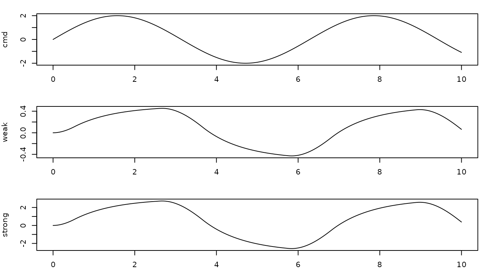

# Hierarchical subsystems

``` r

library(simcompR)
```

A subsystem is a model used as a block. It declares its interface with
`inport` and `outport` blocks and can be instantiated any number of
times, with its own parameters, inside other models and other
subsystems.

## Defining a reusable actuator

An actuator that saturates its command at \pm 1, applies a gain and
responds with a first-order lag \frac{1}{s + 1}:

``` r

actuator <- sim_subsystem("actuator", params = list(gain = 1))
sim_add_block(actuator, "inport", "command", index = 1)
sim_add_block(actuator, "saturation", "sat", lower = -1, upper = 1)
sim_add_block(actuator, "gain", "k", gain = sim_param("gain"))
sim_add_block(actuator, "transfer_function", "lag", num = 1, den = c(1, 1))
sim_add_block(actuator, "outport", "force", index = 1)
sim_connect(actuator, "command", "sat")
sim_connect(actuator, "sat", "k")
sim_connect(actuator, "k", "lag")
sim_connect(actuator, "lag", "force")
```

`index` sets the port number of each `inport` and `outport`. Indices
must be 1, 2, … without gaps.

## Instantiating it

``` r

m <- sim_model("two_actuators")
sim_add_block(m, "sine", "cmd", amplitude = 2, frequency = 1)
sim_add_block(m, "subsystem", "weak", system = actuator, params = list(gain = 0.5))
sim_add_block(m, "subsystem", "strong", system = actuator, params = list(gain = 3))
sim_connect(m, "cmd", "weak")
sim_connect(m, "cmd", "strong")
plan <- sim_compile(m)
plan$diagnostics$order
#>  [1] "cmd"            "strong/command" "strong/lag"     "strong/force"  
#>  [5] "strong/sat"     "strong/k"       "weak/command"   "weak/lag"      
#>  [9] "weak/force"     "weak/sat"       "weak/k"
r <- sim_run(plan, c(0, 10))
plot(r, c("cmd", "weak", "strong"))
```



After compilation each instance’s blocks are named `instance/block`. The
instance name itself refers to its output, and inner signals remain
available:

``` r

head(sim_signal(r, c("weak", "strong/sat")), 3)
#>             weak strong/sat
#> [1,] 0.000000000 0.00000000
#> [2,] 0.001229168 0.09995834
#> [3,] 0.004833336 0.19966683
colnames(sim_states(r))
#> [1] "strong/lag" "weak/lag"
```

## Parameter namespaces

A `sim_param("name")` inside a subsystem is resolved in this order:

1.  the instance’s `params`;
2.  the subsystem’s default `params`;
3.  the enclosing model (or enclosing subsystem instance), and so on up
    to the top-level model.

Instance parameters may themselves refer to the parent’s parameters,
which makes it possible to drive many components from one top-level
value:

``` r

top <- sim_model("shared", params = list(G = 2))
sim_add_block(top, "constant", "u", value = 0.4)
sim_add_block(top, "subsystem", "a1", system = actuator,
              params = list(gain = sim_param("G")))
sim_connect(top, "u", "a1")
p <- sim_compile(top)
sim_signal(sim_run(p, c(0, 20), times = 20), "a1")
#>  a1 
#> 0.8
sim_signal(sim_run(sim_set_params(p, G = 5), c(0, 20), times = 20), "a1")
#> a1 
#>  2
```

## No shared state

Each instance gets its own copy of the inner blocks, so instances never
share state. Changing the initial state of one does not affect the
other:

``` r

r <- sim_run(plan, c(0, 1), times = 1, initial = list(`weak/lag` = 1))
sim_signal(r, c("weak", "strong"))
#>      weak    strong 
#> 0.6276589 1.5586739
```

## Nesting

Subsystems can contain subsystems. Two actuators in series inside a
“drive train”:

``` r

train <- sim_subsystem("train")
sim_add_block(train, "inport", "in", index = 1)
sim_add_block(train, "subsystem", "first", system = actuator)
sim_add_block(train, "subsystem", "second", system = actuator)
sim_add_block(train, "outport", "out", index = 1)
sim_connect(train, "in", "first")
sim_connect(train, "first", "second")
sim_connect(train, "second", "out")
outer <- sim_model("vehicle")
sim_add_block(outer, "step", "u", time = 0, after = 0.5)
sim_add_block(outer, "subsystem", "drive", system = train)
sim_connect(outer, "u", "drive")
r <- sim_run(sim_compile(outer), c(0, 5), times = 5, rtol = 1e-10, atol = 1e-12)
# two unit lags in series: 1 - (1 + t) exp(-t), scaled by 0.5
c(simulated = sim_signal(r, "drive"), exact = 0.5 * (1 - 6 * exp(-5)))
#> simulated.drive           exact 
#>       0.4797862       0.4797862
```

## Equivalence with the flattened model

Flattening is exact: a model built from subsystems and the same model
built by hand produce identical numbers. The test suite checks this for
every release.

## Diagnostics with paths

Errors inside an instance name the full path:

``` r

broken <- sim_subsystem("broken")
sim_add_block(broken, "inport", "u", index = 1)
sim_add_block(broken, "gain", "k", gain = sim_param("missing"))
sim_add_block(broken, "outport", "y", index = 1)
sim_connect(broken, "u", "k")
sim_connect(broken, "k", "y")
host <- sim_model("host")
sim_add_block(host, "constant", "c")
sim_add_block(host, "subsystem", "b", system = broken)
sim_connect(host, "c", "b")
sim_compile(host)
#> Error:
#> ! Block 'b/k': parameter reference 'missing' is not defined in any enclosing scope.
```
